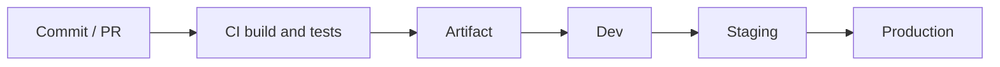

# Deployment

Last reviewed: YYYY-MM-DD

- Evidence scope: [Pipeline files, Dockerfiles, IaC, release scripts inspected; settings not visible in the repository (portal configuration, manual steps)]

How the project gets from a commit to running in each environment, and how to roll back. Quality gates and local setup are in `quality-and-deployment.md`.

## Deployment strategy
[Plain-language summary: what is deployed (each sub-project), where it runs, how often, who or what triggers it, the rollout style (rolling, blue-green, canary, slot swap, recreate, manual copy), and how safe it is. Label Verified / Inferred / Unknown.]

## Deployment flow

[Replace with the real flow. Mark manual approvals and inferred steps.]

## What is deployed
| Sub-project | Artifact (image, package, bundle, function zip) | Registry / store | Versioning / tagging | Target (service, cluster, app, store) | Evidence |
|---|---|---|---|---|---|

## Environments
| Environment | Purpose | How deployed (trigger, pipeline, approvals) | Config source | Required variable names | Evidence |
|---|---|---|---|---|---|

## Pipelines
| Pipeline | Trigger | Stages (build → test → package → deploy) | Deploys to | Evidence |
|---|---|---|---|---|

## Infrastructure
[IaC tool, stacks or modules, state location (path only), key resources (compute, data, networking, identity). `Not applicable — <evidence>` if infrastructure is not in this repository.]

## Configuration and secrets
[Configuration sources per environment; secret stores by name and location. Never values.]

## Database migrations
[When and how migrations run relative to the code deployment; who runs them; rollback approach.]

## Release process
- Versioning and tags:
- Changelog / release notes:
- Feature flags and default states:
- Approvals:

## Rollback
[Exact rollback procedure per sub-project, how long it takes, and how data changes affect it. `Unknown` with a Q-NNN if there is no documented rollback.]

## Post-deploy verification
[Health checks, smoke tests, dashboards and metrics to watch, alerts.]

## Observability in deployed environments
[Logging destination, metrics, tracing, alerting, dashboards; evidence or Unknown.]

## Manual steps and unknowns
- [Steps done by hand or settings outside the repository → Q-NNN]

## Recommended improvements
| Improvement | Why | Effort | Priority | Task |
|---|---|---|---|---|
